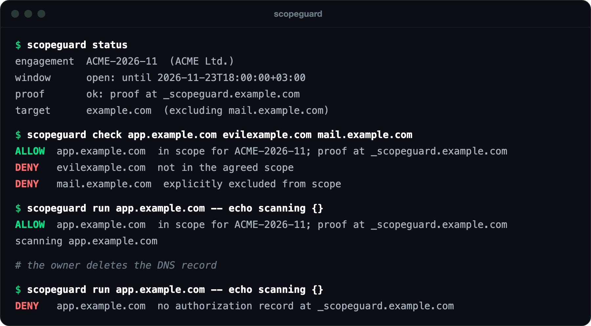

# scopeguard

**Refuse to test what you are not authorized to test.**

[](https://github.com/tuncasoftbildik/scopeguard/actions/workflows/tests.yml)


<p align="center"></p>

The most expensive mistake in a penetration test is not a missed finding. It is a packet sent to a system nobody agreed to: a typo in a domain, a window that closed yesterday, a subdomain that turned out to be somebody else's SaaS.

scopeguard sits in front of your tools. A command runs only when three things hold **at that moment**:

1. the target is inside the scope agreed for this engagement,
2. the agreed time window is open,
3. the owner still publishes a DNS record that vouches for the engagement.

One file, standard library only, Python 3.11+.

## How it works

```console
$ scopeguard init ACME-2026-11 example.com --client "ACME Ltd."
Wrote scope.toml (window: 7 days from now; edit it to match the signed agreement).

Ask the owner to publish this DNS TXT record before the window opens:

  name   _scopeguard.example.com
  type   TXT
  value  v=sg1; id=ACME-2026-11; h=9f2c…e1; exp=2026-11-27

Deleting the record withdraws the authorization at once.
```

`scope.toml` holds a random token and stays with you. The owner publishes only its SHA-256, so the record proves two things: they control the domain, and they agreed to *this* engagement with *this* tester. Then every tool goes through the guard:

```console
$ scopeguard run app.example.com -- nmap -sV {}
ALLOW  app.example.com  in scope for ACME-2026-11; proof at _scopeguard.example.com
…nmap runs…

$ scopeguard run evilexample.com -- nmap -sV {}
DENY   evilexample.com  not in the agreed scope
```

The record is also a kill switch in the owner's hands. If they delete it, the next command is refused; nobody has to reach you by phone first.

## Install

```console
pipx install git+https://github.com/tuncasoftbildik/scopeguard
```

Or copy `scopeguard.py` next to your notes and run it with `python3`.

## Commands

| Command | What it does |
| --- | --- |
| `scopeguard init ID DOMAIN...` | Create `scope.toml` with a fresh token and print the DNS record |
| `scopeguard record` | Print the DNS record again |
| `scopeguard status` | Show whether the window is open and the proof records are in place |
| `scopeguard check TARGET...` | Say whether targets may be tested right now |
| `scopeguard run TARGET -- COMMAND` | Run the command only if the target is authorized; `{}` becomes the target |

A target can be a host name, a URL, an address or a CIDR range. Exit status: `0` allowed, `3` denied, `2` configuration problem; `run` passes through the status of the command it ran.

## What gets refused

| Situation | Answer |
| --- | --- |
| Look-alike domain (`evilexample.com` for `example.com`) | `not in the agreed scope` |
| Host or address the client carved out | `explicitly excluded from scope` |
| Before the start or after the end of the window | `the agreed window opens at…` / `closed at…` |
| The owner removed the record | `no authorization record at _scopeguard.example.com` |
| A record for another engagement or another tester's token | `…is for a different engagement` / `…does not match the token…` |
| An in-scope name that points at third-party hosting | `resolves to 198.51.100.20, outside the agreed ranges (third-party hosting?)` |
| The command names a different host than the one checked | `the checked target does not appear in the command` |
| DNS cannot be reached | `could not query…` (no answer means no) |

## Scope file

```toml
[engagement]
id = "ACME-2026-11"
client = "ACME Ltd."
token = "sg_…"                          # private; only its SHA-256 is published
not_before = 2026-11-20T09:00:00+03:00
not_after = 2026-11-27T18:00:00+03:00

[[target]]
domain = "example.com"                  # the domain and every subdomain
exclude = ["mail.example.com", "203.0.113.9"]

[[target]]
domain = "shop.example.com"
proof = "example.com"                   # which domain's record vouches for it
resolves_within = ["203.0.113.0/28"]    # deny if DNS points anywhere else

[[target]]
cidr = "203.0.113.0/28"
proof = "example.com"                   # ranges always name their proof domain
```

`resolves_within` is for the classic trap: `shop.example.com` is in the contract, but it is a CNAME to a hosted shop platform. Testing it means attacking a company that never signed anything.

## Audit trail

Every decision is appended to `scopeguard.log` next to the scope file, one JSON object per line: time (UTC), engagement, target, verdict and reason, the command and its exit status. The token is never written. The log goes into the report appendix and answers "what did you run against us, and when?" without anyone relying on memory.

```json
{"ts": "2026-11-22T09:14:03+00:00", "engagement": "ACME-2026-11", "event": "run", "target": "app.example.com", "reason": "in scope for ACME-2026-11; proof at _scopeguard.example.com", "command": ["nmap", "-sV", "app.example.com"]}
{"ts": "2026-11-22T09:15:41+00:00", "engagement": "ACME-2026-11", "event": "exit", "target": "app.example.com", "code": 0}
```

## What this is not

- **Not the authorization itself.** The signed rules of engagement are. The record is a tripwire against mistakes and a way for the owner to stop the work, not a legal document.
- **Not proof against a hostile network.** Plain DNS is not authenticated. Point `SCOPEGUARD_RESOLVER` at a resolver you trust (`1.1.1.1`, or `host:port`).
- **Not a sandbox.** It guards the commands you run through it. A tool started directly is not checked, so make the wrapper a habit: shell aliases help.

## Templates and checklists

The paperwork that goes with the tool, written to be filled in rather than admired:

| File | Use |
| --- | --- |
| [`templates/rules-of-engagement.md`](templates/rules-of-engagement.md) | Scope, window, limits, contacts and stop conditions, signed before anything starts |
| [`templates/report.md`](templates/report.md) | Report skeleton: summary for management, findings, remediation plan |
| [`templates/rapor.tr.md`](templates/rapor.tr.md) | The same report in Turkish (Sızma Testi Raporu) |
| [`templates/finding.md`](templates/finding.md) | One finding: evidence, impact, fix, retest |
| [`checklists/external-surface.md`](checklists/external-surface.md) | External attack surface, passive steps first |
| [`checklists/web-application.md`](checklists/web-application.md) | Web application checks mapped to OWASP WSTG categories |

## Tests

```console
python3 -m unittest discover -s tests
```

46 tests. The DNS client is exercised over the wire against a small server on localhost, so the suite needs no network.

## License

MIT
